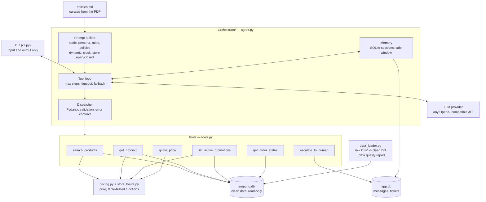

# Empório da Música — AI customer service agent

> A text-message agent that answers customers of a (fictional) musical instrument store in
> Campo Grande/MS, using the store's own operational data and its policy manual.
> Built for the Artefact AI Engineer technical challenge.

**The idea in one line:** the LLM decides and writes; Python fetches the facts and does the
arithmetic. Everything else here follows from that split.

- Native **tool calling** with a small, readable loop — no agent framework.
- **No invented numbers.** Prices, stock, promotions, installments and shipping come from
  tools; money is computed in `pricing.py` with `Decimal`, never by the model.
- **Order privacy.** Order data only after the requester proves the order is theirs, and an
  unknown order answers exactly like a wrong contact, so the catalogue of orders cannot be
  enumerated.
- **Knows when to hand off** — complaints, refunds, inconsistent data — and says when the team
  will reply, computed from the store's opening hours.
- **Behavioural evaluation** of 19 scenarios, plus 332 unit and loop tests that run with no API
  key at all.
- Full **spec-driven documentation** in [`specs/`](specs/MAP.md).

## Example conversations

Generated from real runs by `scripts/run_examples.py`, with the clock fixed so they are
reproducible. The agent's words are never edited by hand.

| | Conversation | What it shows |
|---|---|---|
| 1 | [Catalogue search and a recommendation](examples/01_catalog_search.md) | A plain sentence becomes filters; the recommendation comes from specifications actually read |
| 2 | [Ambiguity, price and payment rules](examples/02_price_and_payment.md) | Four Takamine match, so it asks; then PIX and installments are computed, not estimated |
| 3 | [**Order lookup, identity check and hand-off**](examples/03_order_return_escalation.md) | **The non-trivial one:** refuses to read the order until identity is proven, spots a parcel eight months overdue, refuses to say it is on the way, opens a ticket |
| 4 | [Store information on a closed Sunday](examples/04_store_info_out_of_hours.md) | Policy answers with no tool call; knows the next opening skips a national holiday |
| 5 | [Out of scope, empty categories, prompt injection](examples/05_out_of_scope_and_promos.md) | Three different ways to say no without inventing anything |

## Quickstart

Requirements: **Python ≥ 3.11** and an API key for any OpenAI-compatible provider.

```bash
git clone https://github.com/Eduardozelaya/emporio-agent.git && cd emporio-agent

python -m venv .venv
source .venv/bin/activate          # Windows: .venv\Scripts\activate
pip install -e ".[dev]"

cp .env.example .env               # then set LLM_API_KEY (see below)
python -m emporio build-data       # raw CSV + PDF -> data/processed/emporio.db
python -m emporio chat --debug     # talk to it; --debug shows the tools it calls
```

> **Windows note.** If `python -m emporio` says `No module named emporio`, your shell is using
> the Microsoft Store Python instead of the virtual environment. Either activate the venv or
> call it directly: `.\.venv\Scripts\python.exe -m emporio chat`.

### Choosing a provider

The client speaks the OpenAI protocol to whatever `LLM_BASE_URL` points at, so the provider is
configuration, not code. Set three variables in `.env`:

| Provider | `LLM_BASE_URL` | `LLM_MODEL` |
|---|---|---|
| OpenAI | *(leave empty)* | `gpt-4o-mini` |
| Groq | `https://api.groq.com/openai/v1` | `openai/gpt-oss-120b` |
| DeepSeek | `https://api.deepseek.com` | `deepseek-chat` |
| Ollama (local) | `http://localhost:11434/v1` | `llama3.1` |

This repository was developed against both OpenAI and Groq — see
[the provider trade-off](#provider-trade-off) for why, and what it costs.

### Other commands

```bash
pytest                                   # 332 tests, no API key needed
ruff check .                             # lint
python -m emporio eval                   # live behavioural evaluation -> eval/results.md
python -m emporio eval --only S07 S13    # just these scenarios
python -m emporio tool get_product '{"name": "Takamine GD20"}'   # call a tool by hand
python -m emporio sessions               # list saved conversations
python -m emporio chat --session <id>    # resume one
python scripts/run_examples.py           # regenerate examples/
```

## Architecture



**One turn, step by step.** The customer asks "Quanto custa o Takamine GD20?". The orchestrator
loads the recent history, builds the system prompt and sends the message together with the six
tool schemas. The model answers with a *request* for `get_product`, not with a price. The
dispatcher validates the arguments, runs the tool, and appends the result. The model sees
`{"price": 2199.0, ...}` and only now writes a sentence. If the customer then asks "e no PIX?",
the same loop calls `quote_price`, which returns `2089.05` computed in Python.

The boundary matters more than the loop: **the model has no access to the database**. It can
only name a tool. Whatever the model is persuaded to say, it cannot read another customer's
order or produce a price that is not in the data.

## Technical decisions

Full reasoning with the alternatives considered: [`specs/DECISIONS.md`](specs/DECISIONS.md)
(D0–D21). The short version:

| Topic | Choice | Why |
|---|---|---|
| **Agent approach** | Native tool calling, hand-written loop | The answer depends on data, so the model must *see* results before writing. Six tools and one loop do not need a framework — the loop is ~60 readable lines, and in an interview I can defend every one of them. |
| **Why not a SQL agent** | Rejected | Free SQL can join wrongly or read another customer's row. Closed tools put the identity check *in code*, where it cannot be prompted away. |
| **Why not intent classification** | Rejected | It makes the model write the reply before it has seen the data, which needs a second call or rigid templates. |
| **Retrieval** | No RAG — the whole manual in the system prompt | Eight pages, ~3.5k tokens. Zero retrieval errors, and the prefix is cacheable. Switch to RAG beyond ~30 pages or several documents. |
| **Model / provider** | Any OpenAI-compatible endpoint, chosen by env | See [trade-off](#provider-trade-off). Developed against OpenAI `gpt-4o-mini` and Groq `openai/gpt-oss-120b`. |
| **Prompt strategy** | Static prefix (persona, rules, scope, few-shots, manual) then dynamic suffix (clock, open/closed) | The prefix is byte-identical every turn so a provider can cache it; a test asserts that. The prompt states *behaviour* and never *facts*. |
| **Data** | Raw CSV → cleaned SQLite, opened read-only at runtime | Filters and joins with parameterised SQL, inspectable with `sqlite3`, rebuilt by one idempotent command. Read-only mode is enforced by SQLite, not by discipline. |
| **Money and time** | Pure Python with `Decimal` | Deterministic, table-tested, and the one place a rounding rule lives. The model is explicitly forbidden from doing arithmetic. |
| **Privacy** | Verify e-mail or phone before any order data | LGPD and manual §9. Unknown order and wrong contact return the *same* error. |
| **Memory** | SQLite sessions, sliding window that never splits a tool-call group | Follow-ups work ("e em 6x?"), sessions survive a restart, and the window can never produce the orphan `tool` message the API rejects. |
| **Interface** | CLI with `/debug` | `/debug` shows which tool ran with which arguments — the clearest possible evidence that the agent knows when to query data and when to read the manual. |

### Provider trade-off

The OpenAI account ran out of credits during the build. Moving to Groq took three lines of
`.env` and no code change, which is the whole point of the decision above. The free tier has a
real cost, measured rather than assumed:

| | OpenAI `gpt-4o-mini` | Groq `openai/gpt-oss-120b` (free) |
|---|---|---|
| Tokens per minute | tens of thousands | **8,000** |
| Our system prompt | ~6.6k tokens per call | ~6.6k tokens per call |
| Turn answered from the manual | ~2 s | ~2 s |
| Turn with one tool call (two model calls) | ~3 s | **up to ~100 s** |

With a 6.6k-token prompt, one call nearly exhausts a minute of free-tier budget, so the second
call of a turn has to wait for the quota to reset. The agent stays *correct* either way — the
retry reads the provider's own `retry-after` and waits it out — but iterating on prompts and
running the full evaluation is far slower. Switching back is three lines.

## Data treatment

`python -m emporio build-data` reads `data/raw/`, never writes to it, and produces
`data/processed/emporio.db` plus [`reports/data_quality.md`](reports/data_quality.md).

The loader found **19 issues** in the provided data. Each one is stored in the database and
listed in the report together with what the agent does about it:

| Finding | Count | How the agent handles it |
|---|---|---|
| PIX orders charged at list price | 5 | Flagged, not corrected: the recorded total is what the customer paid |
| Categories with no products (wind instruments, orchestral strings) | 3 | Says we do not carry them right now; never invents a model or a price |
| Installment below the manual's own minimum | 3 | Historical only; new quotes go through `pricing.quote`, which enforces the tiers |
| A product sold before release | 2 | Does not promise delivery for those orders — explains and escalates |
| Order total ≠ sum of its items | 2 | Shows the recorded total, never recomputes it |
| Active product with zero stock | 1 | Derived as out of stock: the price is real, the delivery is not promised |
| Discontinued product still in stock | 1 | Status wins over stock; offers equivalents |
| The same person registered twice | 1 | Verification by e-mail works for both records |
| Promotion attached to a product we cannot sell | 1 | Never applied |

Derivations worth naming:

- **`availability`** is derived from `status` and `stock_quantity`, in that order of authority.
  Product 136 is discontinued *with 13 units in stock* — status wins, we do not sell it.
- **`specs.strings`** means the string **material** (`nylon`/`steel`) for acoustic guitars and
  ukuleles, but the string **count** (`"6"`, `"4"`) for electric guitars and basses. Deriving it
  everywhere would have put `6` into a material filter, so only categories 5 and 9 get it.
- **`payment_method`** `credit_12x` is split into a method and a number of installments.
- The policy PDF extracts as one word per line with every table flattened, so
  [`policies.md`](data/processed/policies.md) is curated by hand, reviewed line by line against
  the original, and committed. Tests assert that all ten sections and eleven key facts survive
  any future edit.

## Assumptions

The challenge says to assume, document and move on. The full list with reasoning is in
[`specs/03_POLICY_NOTES.md`](specs/03_POLICY_NOTES.md) (A1–A14); these are the ones that change
what a customer is told:

| Ambiguity | Assumption |
|---|---|
| §3 says "minimum installment R$ 100" but §3.1 gives tiers of R$ 50 / 80 / 100 | The specific rule wins: **≤3x R$ 50 · 4–6x R$ 80 · 7–12x R$ 100**. 1x always allowed. |
| The manual lists two phone numbers | Use **(67) 3341-4444**, the official company record, which appears twice |
| §1.2 writes the e-mail with an accented domain | Use `contato@emporiodamusica.com.br` |
| §5.1 covers "above" and "below" R$ 500 but not exactly R$ 500,00 | **R$ 500,00 ships free** — read in the customer's favour |
| Sundays "and holidays" are closed, but no holiday is listed | A minimal **national** calendar lives in `store_hours.py`, including the Easter-derived dates. Without it the agent would have announced an opening on 02/11, which is Finados |
| "24 business hours" for a complaint has no counting rule | Read as **one business day**: the same time on the next day the store opens, clamped to closing time |
| The withdrawal window counts from receipt, which the data does not record | The agent **asks the customer** when they received it |
| Orders carry no sales channel | Assumed online, so §4.1 applies |
| §7.1 says to suggest partner stores, but none are listed | Never invent a shop name; just explain the scope |
| §1 claims "more than 300 instruments"; the catalogue has 65 | Only ever talk about what the system returns |

The customer data is fictitious and was supplied with the challenge, so committing it to a
public repository is fine.

## Evaluation

Three layers, because they catch different things:

1. **332 unit and loop tests** — pure logic, the tools, and the whole agent loop driven by a
   scripted fake model. No API key, no network, so CI runs them on every push.
2. **19 live behavioural scenarios** (`python -m emporio eval`) — see below.
3. **Five example conversations**, generated from real runs.

Scenarios assert on *behaviour*, not wording, because a model never writes the same sentence
twice: which tool ran, which tools must **not** run, which facts must appear, which must never
appear. The strongest check is `numbers_grounded` — every number in a reply must exist in a tool
result, in what the customer said, or in the policy manual. That is "do not invent prices"
turned into an assertion.

Latest run, with the full report in [`eval/results.md`](eval/results.md):

<!-- EVAL_SUMMARY -->

## Known limitations

- **Holidays are national only.** Municipal and state dates for Campo Grande/MS are not covered;
  the manual lists none at all, so this is already more than it specifies.
- **Shipping outside the metro area is not calculated.** The manual says it depends on CEP,
  weight and dimensions, none of which we have. The agent explains the rule and offers a quote
  through the team rather than guessing a number.
- **Identity verification is prototype-level.** Matching an e-mail or a phone against the order
  is enough to demonstrate the concern, not enough to be authentication.
- **No summarisation of long conversations.** Beyond `HISTORY_WINDOW` messages the oldest turns
  simply fall out of the window.
- **Free-tier latency.** See the [provider trade-off](#provider-trade-off): correct, but slow.
- **Some catalogue rows look synthetic** (products 135–144 have generic names and odd prices).
  They are kept as provided rather than filtered, and flagged in the data quality report.
- **Documentation is in English, the agent speaks Brazilian Portuguese.** That is deliberate:
  the store's customers are Brazilian; the reviewers of this repository are not necessarily.

## What I would do with more time

- **A real channel.** A WhatsApp webhook would replace `cli.py` and nothing else — the interface
  holds no business logic. I have built one in production before.
- **Summarised long-term memory**, so a returning customer does not start from zero.
- **RAG for the policies** once there is more than one document, or per-store manuals.
- **Trim the prompt.** Six and a half thousand tokens per call is the single biggest operational
  cost here. Splitting the manual into sections and sending only what a turn needs would cut it
  substantially — at the price of the retrieval errors that D2 currently avoids entirely.
- **An admin view of escalation tickets**, which are already stored and have nowhere to be read.
- **Observability** on the data the agent already logs: hand-off rate, tool error rate, cost per
  conversation, and how often the fallback fires.
- **Evaluation in CI** against a cheap model, so a prompt change cannot quietly regress
  behaviour.

## How I used AI coding assistants

I used **Claude** for analysis and planning and **Claude Code** for implementation. The workflow
was spec-driven, and the specs are in this repository so the process is auditable, not just
described.

**1. Analysis before any code.** I read the challenge, the six CSVs and the eight-page manual,
and wrote down what I found before deciding anything: [the verified data
findings](specs/02_DATA_FINDINGS.md), [the policy notes with every
ambiguity](specs/03_POLICY_NOTES.md), and [the decision log](specs/DECISIONS.md). Every number in
the findings document was checked against the raw files with a script, and the E1 tests
reproduce them automatically — so the document cannot silently drift from the data.

**2. Specs, then epics, then code.** Eight epics (E0–E7) with EARS-style acceptance criteria and
a task-per-commit table. Claude Code worked one task at a time against those criteria; I
reviewed every diff before it was committed.

**3. What I decided myself.** Tool calling over a SQL agent or intent classification; no RAG at
this document size; money and time rules in Python rather than in the prompt; identical errors
for "no such order" and "wrong contact"; keeping recorded order totals rather than recomputing
them; adding a holiday calendar the manual does not provide.

**4. Where I corrected the assistant.** The full log is in
[`specs/PAUSE_WORK.md`](specs/PAUSE_WORK.md). The ones that mattered:

| What it did | What I changed, and why |
|---|---|
| Wrote `.gitattributes` with a blanket `text=auto` | It was silently rewriting the line endings of the original CSVs. `data/raw/` is evidence; a clone has to match the files the store handed us byte for byte. |
| Rounded the PIX discount and the total interchangeably | 799.90 × 5% = 39.995. I chose to round the **discount** to R$ 40.00 and subtract, not to round the total — only the first can be printed on a receipt as real money. One centavo, but it is the kind of centavo a store notices. |
| Derived `strings` for every category | In electric guitars that field is a string *count*, not a material. The filter would have been nonsense. |
| Let a commit message describe less than its diff | Amended before pushing. The commit history is something the evaluator reads. |
| Retried a failing provider after 0.5 s | The provider was answering "try again in 42s". The first live run fell back on all seven questions because of it. |
| Swallowed the provider's error | The fallback was right, but it hid "no credits remaining" — the one sentence that explained the outage. The reason now reaches the operator and the logs; the customer still sees only the neutral message. |
| Wrote a test naming a command that was "not implemented yet" | Twice the epic that implemented it turned that test into one that really ran the command — the second time it fired all nineteen live evaluation scenarios and hung the suite. A test must never depend on something staying unbuilt. |

**5. Live runs drove the prompt, not my taste.** The first real conversation produced two prompt
bugs I would not have predicted: the model read "show at most 5" as a *query* limit and fetched
only five products, and it asked "what is your maximum price?" to someone who had just said
"up to R$1000". Both are fixed, and both became rules in the prompt.

## Project structure

```
data/raw/            the challenge files, renamed only, never modified
data/processed/      policies.md (curated, committed) + emporio.db (generated)
reports/             data quality report (generated, committed)
src/emporio/
  config.py          settings and a controllable clock (EMPORIO_TODAY)
  data_loader.py     raw CSV -> clean SQLite + quality findings
  policies.py        PDF -> text; loads the curated manual
  pricing.py         promotions, PIX, installments, shipping — all the money
  store_hours.py     opening hours, holidays, the escalation SLA
  db.py              read-only store data, read-write app data
  tools.py           the six tools, their schemas and the safe dispatcher
  prompts.py         persona, rules, scope, few-shots, manual, dynamic context
  llm.py             OpenAI-compatible client with timeout and rate-limit retry
  agent.py           the tool-calling loop and its guards
  memory.py          sessions and the window that never splits a tool group
  cli.py             interactive chat with /debug
  eval.py            behavioural scenario runner
tests/               332 tests, none of which need an API key
eval/                scenarios.yaml and results.md
examples/            five conversations from real runs
specs/               the full spec-driven documentation — start at specs/MAP.md
```

## License

MIT — see [LICENSE](LICENSE).
