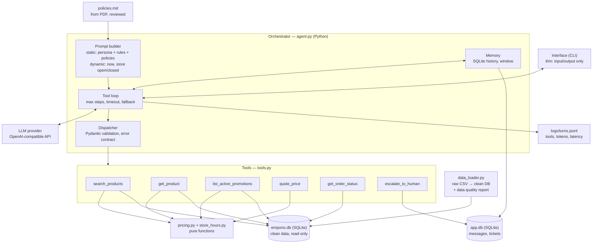
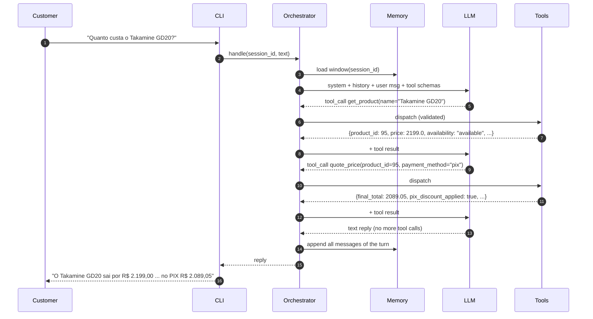
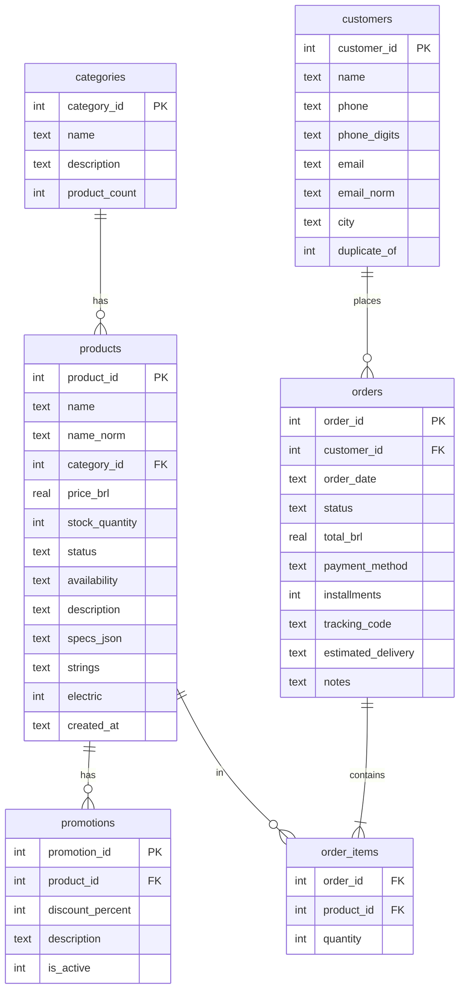

# 01 — Architecture

> The **how** for [00_PROJECT_SPEC](00_PROJECT_SPEC.md). Decisions and their alternatives are in
> [DECISIONS](DECISIONS.md). Epics reference the sections below by number.

## 1. Core idea

**The LLM decides and writes; Python fetches facts and does the math.**

The LLM never touches data directly. It can only *request* a tool by name with arguments. The
orchestrator (plain Python) validates the request, runs the tool, and sends the result back.
That boundary is where accuracy and privacy are enforced.

## 2. Components



| Component | Responsibility | Must NOT |
|---|---|---|
| Interface (`cli.py`) | Read input, print reply, session commands (`/new`, `/debug`, `/exit`) | Contain business logic (so a WhatsApp/API adapter can replace it) |
| Prompt builder (`prompts.py`) | Assemble system prompt: static prefix (persona, rules, scope, policies) + dynamic suffix (current date/time, store open/closed computed in code) | Put dynamic data before static data (breaks prompt caching) |
| Tool loop (`agent.py`) | Call LLM, execute requested tools, repeat until a text answer or `MAX_TOOL_STEPS` | Loop forever; crash on tool error; hang on a slow provider |
| Dispatcher (`tools.py`) | Map tool name → function, validate args with Pydantic, return structured errors | Raise exceptions into the loop |
| Tools (`tools.py`) | Read clean data, call pricing, enforce verification, create tickets | Return raw tables or customer PII the requester didn't prove ownership of |
| Pricing & hours (`pricing.py`, `store_hours.py`) | Promotion, PIX discount, installments, store open/closed — pure and unit-tested | Depend on the LLM or I/O |
| Memory (`memory.py`) | Persist every message (incl. tool calls/results) per session; load a window | Cut a window between an assistant `tool_calls` message and its `tool` results |
| Data loader (`data_loader.py`) | Raw → clean SQLite, derive fields, flag anomalies, write `reports/data_quality.md` | Modify files in `data/raw/` |
| Logs | One JSON line per turn: session, tools + args, tokens, latency, model, fallback used | Log customer e-mail/phone in clear text |

## 3. One turn, step by step



## 4. Prompt layout

Order matters for prompt caching (fixed prefix first) and for clarity.

1. **Identity & persona** — who the assistant is, tone (manual §7.1), Portuguese (pt-BR).
2. **Golden rules** — never state price/stock/discount/installment/order facts without a tool
   result; never compute money yourself (use `quote_price`); ask before showing order data if
   no e-mail/phone given; one clarifying question when ambiguous.
3. **Scope** — what the store sells (instruments only), what it does not (accessories list),
   categories that exist but are empty, what the assistant cannot do (cancel/refund/sell) → escalate.
4. **Escalation rules** — the triggers from manual §7.3 and §10 (see epic E4).
5. **Answer style** — short WhatsApp-like messages, show original price + % when there is a
   promotion (manual §6.2), suggest alternatives when out of stock (§7.3).
6. **Few-shot examples** — 2–3 tiny examples (refusal, clarification, escalation).
7. **Store policy manual** — full text of `data/processed/policies.md`.
8. **Dynamic context (suffix)** — current date/time in America/Campo_Grande, store open/closed
   and next opening (computed by `store_hours.py`).

## 5. Tool contracts

All tools return JSON-serialisable dicts. Errors are data, not exceptions:
`{"error": "<code>", "message": "<human-readable hint for the LLM>"}`.
Money values are numbers in BRL with 2 decimals.

| Tool | Arguments | Returns (success) | Error codes |
|---|---|---|---|
| `search_products` | `query?` str, `category?` enum(category names), `min_price?`, `max_price?` number, `strings?` enum(nylon, steel), `electric?` bool, `include_unavailable` bool=false, `limit` int=12 (≤15) | `{items:[{product_id, name, category, price, promo:{percent, price}\|null, availability, stock}], total_found, filters_applied}` | `invalid_arguments` |
| `get_product` | `product_id?` int, `name?` str (one required) | `{product:{..., description, specs}}` or `{matches:[{product_id,name,price}]}` when ambiguous | `not_found`, `invalid_arguments` |
| `list_active_promotions` | — | `{items:[{product_id, name, original_price, percent, promo_price, availability}]}` | — |
| `quote_price` | `product_id` int, `payment_method` enum(pix, debit, credit, boleto), `installments?` int 1–12, `quantity` int=1, `delivery` enum(pickup, metro_campo_grande, other_city)=pickup | `{unit_price, promo, subtotal, pix_discount, final_total, shipping:{cost\|null, free_reason\|null, rule}, grand_total\|null, installments:{requested, allowed, value, reason}, max_installments_allowed, notes[]}` | `not_found`, `not_for_sale` (discontinued/coming_soon), `invalid_arguments` |
| `get_order_status` | `order_id` int, `email_or_phone` str | `{order:{order_id, customer_first_name, status, status_label_pt, order_date, items:[{name, quantity}], total, payment_method_label, tracking_code\|null, estimated_delivery\|null, notes\|null, needs_attention, attention_reason}}` | `verification_failed` (same code for unknown order and wrong contact — no enumeration) |
| `escalate_to_human` | `reason` enum(complaint, cancellation_or_refund, exchange_or_return, policy_exception, data_inconsistency, special_shipping_quote, customer_request, other), `summary` str, `order_id?` int | `{ticket_id, expected_response:"..."}` (computed by `store_hours.py`) | `invalid_arguments` |

Availability values: `available`, `out_of_stock`, `coming_soon`, `discontinued`
(see [02_DATA_FINDINGS](02_DATA_FINDINGS.md) §3).

## 6. Data model (emporio.db, read-only at runtime)



Plus a view `active_promotions` (one row per product, rule in DECISIONS D9) and
`data_quality_issues(entity, entity_id, code, detail)`.

`app.db` (read-write): `messages(session_id, seq, role, content, tool_calls_json, tool_call_id, created_at)`
and `tickets(ticket_id, session_id, reason, summary, order_id, created_at)`.

## 7. Failure handling

| Failure | Behaviour |
|---|---|
| LLM timeout / error | One retry; then fixed safe reply (store phone + hours) and log `fallback=true` |
| Tool raises unexpectedly | Dispatcher catches → `{"error":"internal_error"}`; LLM apologises and offers escalation |
| Invalid tool args from LLM | `{"error":"invalid_arguments", "message": <pydantic summary>}` → LLM can correct itself |
| Unknown tool name | `{"error":"unknown_tool"}` |
| `MAX_TOOL_STEPS` (default 5) reached | Stop, fixed reply offering a human, log it |
| History too long | Window of last `HISTORY_WINDOW` messages (default 20), never splitting tool-call groups |
| Empty / huge input | CLI rejects empty; truncates input > 2,000 chars with a note |

## 8. Configuration (`.env`)

| Var | Default | Purpose |
|---|---|---|
| `OPENAI_API_KEY` | — | Required for live chat/eval |
| `LLM_BASE_URL` | OpenAI | Any OpenAI-compatible endpoint (DeepSeek, Groq, Ollama…) |
| `LLM_MODEL` | `gpt-4o-mini` | Model name |
| `LLM_TEMPERATURE` | `0.2` | Low for consistency |
| `LLM_TIMEOUT_S` | `30` | Total request timeout |
| `MAX_TOOL_STEPS` | `5` | Loop guard |
| `HISTORY_WINDOW` | `20` | Messages sent to the LLM |
| `EMPORIO_TODAY` | unset (real now) | Fixed datetime for reproducible examples/tests, ISO format |
| `EMPORIO_DATA_DIR` | `data` | Location of raw/processed data |

## 9. Repository layout

```
emporio-agent/
├── data/raw/                 # original files, renamed only (see 02_DATA_FINDINGS §1)
├── data/processed/           # emporio.db (gitignored), policies.md (committed, reviewed)
├── reports/data_quality.md   # generated by the loader (committed)
├── src/emporio/
│   ├── config.py  data_loader.py  policies.py  pricing.py  store_hours.py
│   ├── db.py      tools.py        prompts.py   llm.py
│   ├── agent.py   memory.py       cli.py       eval.py
├── tests/  (unit + agent loop with fake LLM)
├── eval/scenarios.yaml  eval/results.md
├── examples/                 # 5 conversations from real runs
├── specs/                    # this documentation
├── README.md  CLAUDE.md  pyproject.toml  .env.example
```
