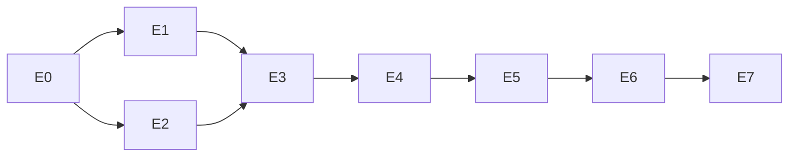

# MAP — Navigation hub

Open this first. Reading order for a new session (human or Claude Code):
**MAP → PAUSE_WORK → the active epic**.

## Foundation documents
- [00_PROJECT_SPEC](00_PROJECT_SPEC.md) — problem, goals, requirement traceability, scope.
- [01_ARCHITECTURE](01_ARCHITECTURE.md) — components, turn sequence, prompt layout, tool contracts, data model, failures, config.
- [DECISIONS](DECISIONS.md) — D0–D17 with options and rationale.
- [02_DATA_FINDINGS](02_DATA_FINDINGS.md) — verified data issues + test oracle.
- [03_POLICY_NOTES](03_POLICY_NOTES.md) — manual index + ambiguity decisions A1–A13.

## Epics (execution order)

| Epic | File | Day | Status |
|---|---|---|---|
| E0 Foundation | [E0_FOUNDATION](epics/E0_FOUNDATION.md) | Sun | ✅ done |
| E1 Data layer | [E1_DATA_LAYER](epics/E1_DATA_LAYER.md) | Sun | ✅ done |
| E2 Domain rules | [E2_DOMAIN_RULES](epics/E2_DOMAIN_RULES.md) | Sun | ✅ done |
| E3 Tools | [E3_TOOLS](epics/E3_TOOLS.md) | Sun/Mon | ✅ done |
| E4 Agent core | [E4_AGENT_CORE](epics/E4_AGENT_CORE.md) | Mon | todo |
| E5 Interface & memory | [E5_INTERFACE_MEMORY](epics/E5_INTERFACE_MEMORY.md) | Mon | todo |
| E6 Evaluation & examples | [E6_EVALUATION_EXAMPLES](epics/E6_EVALUATION_EXAMPLES.md) | Tue | todo |
| E7 Docs & delivery | [E7_DOCS_DELIVERY](epics/E7_DOCS_DELIVERY.md) | Tue | todo |

E1 and E2 are independent (both only need E0) and can be done in either order.

## Live state
- [PAUSE_WORK](PAUSE_WORK.md) — where we stopped, what's next, corrections made to the assistant.
